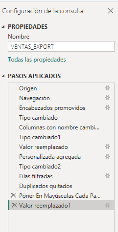
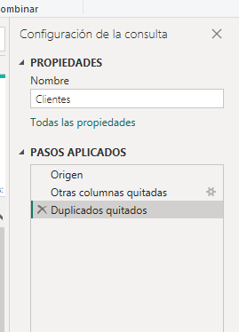
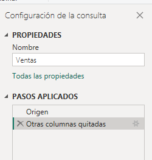
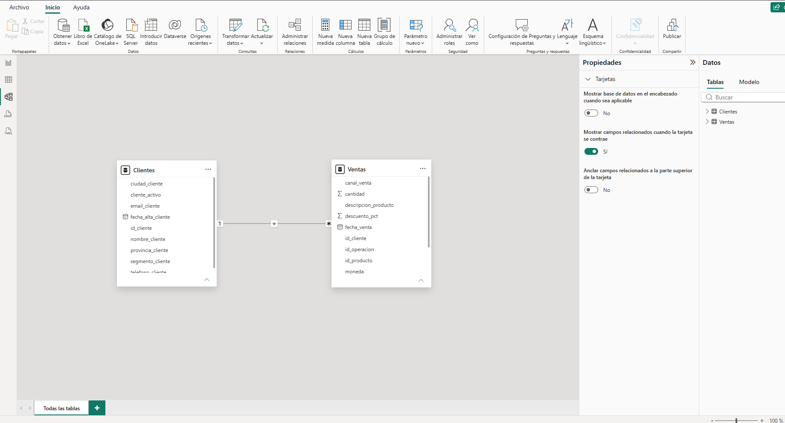

# Limpieza y normalización de datos de ventas con Power BI

## Objetivo

En esta práctica trabajé con una exportación de ventas de un sistema anterior. El objetivo fue importar los datos en Power BI Desktop, limpiarlos y separarlos en tablas que resulten más fáciles de utilizar para un análisis posterior.

La preparación se realizó en Power Query y quedó registrada en el panel **Pasos aplicados**.

## Archivos del proyecto

- `Limpieza_y_Normalizacion_Ventas.pbix`: proyecto de Power BI con las consultas y el modelo.
- `Ventas_export_legacy.xlsx`: archivo Excel utilizado como fuente de datos.
- `capturas/`: imágenes de los pasos aplicados y del modelo final.

> Para actualizar las consultas desde otra computadora, es posible que sea necesario cambiar la ruta local del Excel en el paso **Origen** de Power Query.

## Proceso realizado

### 1. Importación

Importé el archivo `Ventas_export_legacy.xlsx` desde **Obtener datos > Libro de Excel** y seleccioné **Transformar datos** para trabajar primero en Power Query. El archivo original contenía **949 filas y 20 columnas**.

### 2. Renombrar columnas

Reemplacé nombres técnicos por nombres más claros, usando minúsculas y guiones bajos (`snake_case`). Algunos ejemplos fueron:

| Nombre original | Nombre nuevo |
| --- | --- |
| `COD_OP` | `id_operacion` |
| `COD_CLI` | `id_cliente` |
| `NOM_CLI` | `nombre_cliente` |
| `F_VTA` | `fecha_venta` |
| `COD_PROD` | `id_producto` |
| `DTO_PCT` | `descuento_pct` |
| `TOT_VTA` | `total_venta` |
| `CANAL_VTA` | `canal_venta` |

Esto ayuda a identificar el contenido de cada columna sin depender de los códigos del sistema de origen.

### 3. Tipos de datos

Revisé los tipos de datos para evitar errores al filtrar o calcular:

- **Fecha:** `fecha_venta` y `fecha_alta_cliente`, para permitir análisis por fechas.
- **Número entero:** `cantidad`, porque representa unidades vendidas.
- **Número decimal:** `precio_unitario`, `descuento_pct`, `total_venta` y `total_venta_calculado`, porque pueden incluir decimales.
- **Texto:** los nombres, datos de contacto, categorías e identificadores como `id_cliente`, `id_operacion` e `id_producto`. Estos códigos sirven para identificar registros, no para hacer operaciones matemáticas; conservarlos como texto también evita perder posibles ceros iniciales.

### 4. Valores nulos e importes faltantes

Encontré algunos descuentos sin informar y reemplacé los valores `null` de `descuento_pct` por **0**, bajo el supuesto de que representan operaciones sin descuento. Este criterio debería confirmarse con el área comercial en un caso real.

En `total_venta` había importes faltantes. Para intentar recuperarlos, creé `total_venta_calculado`: si existía el total original, lo conservé; en caso contrario, calculé el importe con la fórmula:

```text
cantidad × precio_unitario × (1 - descuento_pct)
```

La fórmula de Power Query utilizada fue:

```powerquery
if [total_venta] = null then
    [cantidad] * [precio_unitario] * (1 - [descuento_pct])
else
    [total_venta]
```

Se trata de una reconstrucción basada en los campos disponibles: supone que no hay impuestos, cargos ni ajustes adicionales. No reemplacé los totales nulos por cero, porque eso podría alterar los resultados del análisis.

También conservé los emails y teléfonos nulos: la falta de un dato de contacto no implica que la venta sea inválida.

### 5. Filas vacías y duplicados

Identifiqué **4 filas sin datos de operación** y las excluí utilizando `id_operacion` como criterio. De las 949 filas iniciales se pasó a **945**.

Después revisé identificadores repetidos. No eliminé filas basándome solamente en `id_operacion`, porque una operación puede tener más de un producto. En la consulta de origen se aplicó **Quitar duplicados considerando todas las columnas**, para eliminar registros completamente repetidos. La consulta quedó con **900 filas**.

### 6. Estandarización de canales

Unifiqué la escritura de `canal_venta`, que tenía diferencias de mayúsculas y tildes, para obtener las categorías **Online**, **Sucursal** y **Telefónico**. Así evitamos separar un mismo canal en categorías distintas.

### 7. Normalización: Clientes y Ventas

A partir de la consulta limpia `VENTAS_EXPORT`, creé dos consultas por **Referencia**, para aprovechar las transformaciones previas sin repetirlas.

**Clientes:** conserva los 9 campos propios del cliente, como `id_cliente`, nombre, email, teléfono, ubicación, segmento, estado y fecha de alta. Quité los repetidos por **`id_cliente`**, no por nombre, porque dos clientes diferentes pueden llamarse igual. La tabla final tiene **119 clientes**.

**Ventas:** conserva **12 columnas** de las transacciones, incluyendo `id_operacion`, `id_cliente`, fecha, producto, cantidad, precio, descuento, importe calculado, moneda y canal. La tabla final tiene **900 filas**.

La consulta `VENTAS_EXPORT` quedó como base de transformación, con la carga al modelo deshabilitada para no duplicar información.

### 8. Relación del modelo

En la Vista de modelo relacioné **`Clientes[id_cliente]` con `Ventas[id_cliente]`**, con cardinalidad **uno a varios (1:*)**, relación activa y filtro cruzado de dirección única. Esto permite analizar las ventas por cliente, segmento o ubicación sin repetir los datos del cliente en cada transacción.

## Capturas del trabajo

### Pasos aplicados: consulta de origen



### Pasos aplicados: Clientes



### Pasos aplicados: Ventas



### Modelo relacional



## Resultado y conclusión

El resultado fue un modelo con **119 clientes** y **900 registros de ventas**, con nombres de columnas más claros, fechas y montos tipados, duplicados tratados y una relación entre las dos tablas.

La principal enseñanza del ejercicio fue que **limpiar datos no es solamente eliminar registros**. Antes de borrar o reemplazar información hay que entender qué representa: un teléfono vacío no invalida una venta, mientras que un importe faltante puede recuperarse si hay datos suficientes. Separar los clientes de sus operaciones también evita repetir información y deja una base más ordenada para futuros reportes.

Como mejora pendiente para un entorno real, validaría con el área comercial las reglas usadas para los descuentos e importes recuperados y revisaría posibles diferencias históricas en los datos de cada cliente antes de elegir su registro definitivo.
